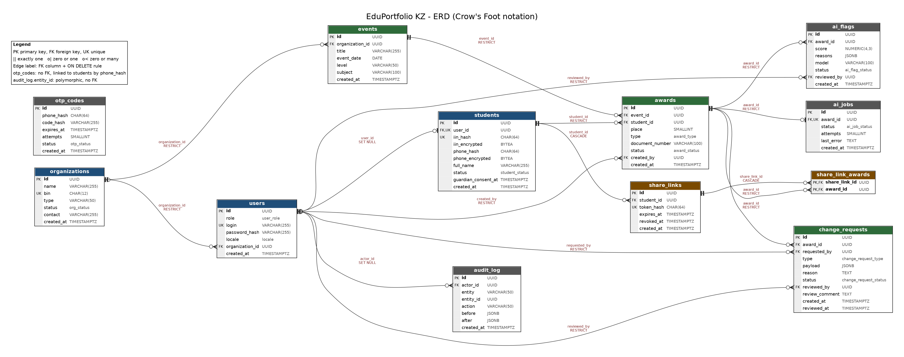

# Database schema

Project: EduPortfolio KZ | Course: PED 741 Software Development Practice | Deliverable 2 (tag `v0.2.0`)

This document describes the PostgreSQL 16 schema of EduPortfolio KZ: the ERD, every table and column, relationship rules, and the reasoning behind the design. The executable version is [`prisma/schema.prisma`](../prisma/schema.prisma). Requirements come from [specifications.md](../specifications.md) (section 7 is the starting point; the changes made while normalizing are listed in section 6 below).

## 1. ERD



Vector version: [erd.pdf](erd.pdf). Notation: Crow's Foot. `||` exactly one, `o|` zero or one, `o<` zero or many. Every edge is labeled with the foreign key column and its `ON DELETE` rule. Colors group tables: blue = identity, green = events and awards, brown = sharing, grey = system.

Two links are intentionally not foreign keys:

- `otp_codes` is tied to a student only by `phone_hash`, because the user does not exist yet while the SMS code is being checked (UC-1).
- `audit_log.entity_id` points to rows of many different tables (polymorphic), so a single FK is not possible.

## 2. Enumerated types

| Type | Values |
|---|---|
| `user_role` | `student`, `organization`, `admin` |
| `locale` | `kk`, `ru` |
| `org_status` | `pending`, `verified`, `rejected`, `suspended` |
| `student_status` | `unclaimed`, `claimed` |
| `award_type` | `diploma`, `certificate` |
| `award_status` | `active`, `corrected`, `revoked` |
| `change_request_type` | `change_iin`, `revoke`, `merge_duplicates` |
| `change_request_status` | `pending`, `approved`, `rejected` |
| `otp_status` | `issued`, `verified`, `expired`, `locked` |
| `ai_flag_status` | `open`, `confirmed`, `dismissed` |
| `ai_job_status` | `queued`, `running`, `done`, `failed` |

## 3. Entities and attributes

Key column: PK primary key, FK foreign key, UK unique. All identifiers are `UUID` generated by the database (`gen_random_uuid()`), so ids cannot be guessed or counted. All timestamps are `TIMESTAMPTZ`.

### `organizations`

Verified bodies that issue diplomas and certificates.

| Column | Type | Key | Constraints | Description |
|---|---|---|---|---|
| `id` | `UUID` | PK | DEFAULT gen_random_uuid() | Organization identifier |
| `name` | `VARCHAR(255)` |  | NOT NULL | Official organization name |
| `bin` | `CHAR(12)` | UK | NOT NULL, UNIQUE, CHECK (bin ~ '^[0-9]{12}$') | Business identification number (BIN) |
| `type` | `VARCHAR(50)` |  | NOT NULL | Organization type (olympiad organizer, school, education department) |
| `status` | `org_status` |  | NOT NULL, DEFAULT 'pending' | pending / verified / rejected / suspended |
| `contact` | `VARCHAR(255)` |  | NOT NULL | Contact person or channel |
| `created_at` | `TIMESTAMPTZ` |  | NOT NULL, DEFAULT now() | Registration request time |

### `users`

Login accounts for students, organization staff and admins.

| Column | Type | Key | Constraints | Description |
|---|---|---|---|---|
| `id` | `UUID` | PK | DEFAULT gen_random_uuid() | User identifier |
| `role` | `user_role` |  | NOT NULL | student / organization / admin |
| `login` | `VARCHAR(255)` | UK | NOT NULL, UNIQUE | Login name |
| `password_hash` | `VARCHAR(255)` |  | NOT NULL | argon2 hash, never the password |
| `locale` | `locale` |  | NOT NULL, DEFAULT 'ru' | Interface language: kk / ru |
| `organization_id` | `UUID` | FK | NULL, ON DELETE RESTRICT, CHECK ((role = 'organization') = (organization_id IS NOT NULL)) | Organization of a staff account; NULL for students and admins |
| `created_at` | `TIMESTAMPTZ` |  | NOT NULL, DEFAULT now() | Account creation time |

### `students`

Student records. Exists before the account (unclaimed) and is linked after SMS-confirmed registration.

| Column | Type | Key | Constraints | Description |
|---|---|---|---|---|
| `id` | `UUID` | PK | DEFAULT gen_random_uuid() | Student record identifier |
| `user_id` | `UUID` | FK, UK | NULL, UNIQUE, ON DELETE SET NULL | Linked account; NULL while unclaimed |
| `iin_hash` | `CHAR(64)` | UK | NOT NULL, UNIQUE | HMAC-SHA256 hex of the IIN, used for lookup |
| `iin_encrypted` | `BYTEA` |  | NOT NULL | Encrypted IIN (never stored in plain text) |
| `phone_hash` | `CHAR(64)` |  | NOT NULL | HMAC-SHA256 hex of the phone, used for lookup |
| `phone_encrypted` | `BYTEA` |  | NOT NULL | Encrypted phone number |
| `full_name` | `VARCHAR(255)` |  | NOT NULL | Full name as entered; compared after normalization |
| `status` | `student_status` |  | NOT NULL, DEFAULT 'unclaimed' | unclaimed / claimed |
| `guardian_consent_at` | `TIMESTAMPTZ` |  | NULL | Guardian consent time for under-18 registrants; NULL if not required |
| `created_at` | `TIMESTAMPTZ` |  | NOT NULL, DEFAULT now() | Record creation time |

### `events`

Competitions and olympiads run by an organization.

| Column | Type | Key | Constraints | Description |
|---|---|---|---|---|
| `id` | `UUID` | PK | DEFAULT gen_random_uuid() | Event identifier |
| `organization_id` | `UUID` | FK | NOT NULL, ON DELETE RESTRICT | Organizing body |
| `title` | `VARCHAR(255)` |  | NOT NULL | Event title |
| `event_date` | `DATE` |  | NOT NULL | Date of the event |
| `level` | `VARCHAR(50)` |  | NOT NULL | Event level (school, regional, national, ...) |
| `subject` | `VARCHAR(100)` |  | NOT NULL | Subject area |
| `created_at` | `TIMESTAMPTZ` |  | NOT NULL, DEFAULT now() | Creation time |

### `awards`

A diploma or certificate of one student in one event. Never deleted.

| Column | Type | Key | Constraints | Description |
|---|---|---|---|---|
| `id` | `UUID` | PK | DEFAULT gen_random_uuid() | Award identifier |
| `event_id` | `UUID` | FK | NOT NULL, ON DELETE RESTRICT | Event the award belongs to |
| `student_id` | `UUID` | FK | NOT NULL, ON DELETE RESTRICT | Award holder |
| `place` | `SMALLINT` |  | NULL, CHECK (place > 0) | Place taken; NULL for participation certificates |
| `type` | `award_type` |  | NOT NULL | diploma / certificate |
| `document_number` | `VARCHAR(100)` |  | NOT NULL, UNIQUE (event_id, document_number) | Number printed on the document |
| `status` | `award_status` |  | NOT NULL, DEFAULT 'active' | active / corrected / revoked |
| `created_by` | `UUID` | FK | NOT NULL, ON DELETE RESTRICT | User who entered the award |
| `created_at` | `TIMESTAMPTZ` |  | NOT NULL, DEFAULT now() | Creation time |

### `change_requests`

Global changes proposed by an organization and decided by an admin.

| Column | Type | Key | Constraints | Description |
|---|---|---|---|---|
| `id` | `UUID` | PK | DEFAULT gen_random_uuid() | Request identifier |
| `award_id` | `UUID` | FK | NOT NULL, ON DELETE RESTRICT | Award to change |
| `requested_by` | `UUID` | FK | NOT NULL, ON DELETE RESTRICT | Organization user who filed the request |
| `type` | `change_request_type` |  | NOT NULL | change_iin / revoke / merge_duplicates |
| `payload` | `JSONB` |  | NULL | New values for the change (never contains IIN in plain text) |
| `reason` | `TEXT` |  | NOT NULL, CHECK (length(btrim(reason)) > 0) | Why the change is needed |
| `status` | `change_request_status` |  | NOT NULL, DEFAULT 'pending' | pending / approved / rejected |
| `reviewed_by` | `UUID` | FK | NULL, ON DELETE RESTRICT | Admin who decided |
| `review_comment` | `TEXT` |  | NULL, CHECK (status <> 'rejected' OR review_comment IS NOT NULL) | Decision comment; required on rejection |
| `created_at` | `TIMESTAMPTZ` |  | NOT NULL, DEFAULT now() | Filing time |
| `reviewed_at` | `TIMESTAMPTZ` |  | NULL | Decision time |

### `share_links`

Time-limited links and QR codes created by a student.

| Column | Type | Key | Constraints | Description |
|---|---|---|---|---|
| `id` | `UUID` | PK | DEFAULT gen_random_uuid() | Link identifier |
| `student_id` | `UUID` | FK | NOT NULL, ON DELETE CASCADE | Student who created the link |
| `token_hash` | `CHAR(64)` | UK | NOT NULL, UNIQUE | SHA-256 hex of the random token; the token itself is never stored |
| `expires_at` | `TIMESTAMPTZ` |  | NOT NULL, CHECK (expires_at > created_at) | Expiry (default 30 days) |
| `revoked_at` | `TIMESTAMPTZ` |  | NULL | Set when the student revokes the link |
| `created_at` | `TIMESTAMPTZ` |  | NOT NULL, DEFAULT now() | Creation time |

### `share_link_awards`

Junction table: which awards a link exposes (N:M between share_links and awards).

| Column | Type | Key | Constraints | Description |
|---|---|---|---|---|
| `share_link_id` | `UUID` | PK, FK | NOT NULL, ON DELETE CASCADE | Link |
| `award_id` | `UUID` | PK, FK | NOT NULL, ON DELETE RESTRICT | Included award |

### `otp_codes`

SMS codes. Linked to students logically by phone_hash, no FK (the user does not exist yet during registration).

| Column | Type | Key | Constraints | Description |
|---|---|---|---|---|
| `id` | `UUID` | PK | DEFAULT gen_random_uuid() | Code identifier |
| `phone_hash` | `CHAR(64)` |  | NOT NULL | HMAC-SHA256 hex of the phone the code was sent to |
| `code_hash` | `VARCHAR(255)` |  | NOT NULL | Hash of the 6-digit code |
| `expires_at` | `TIMESTAMPTZ` |  | NOT NULL | Issue time + 5 minutes |
| `attempts` | `SMALLINT` |  | NOT NULL, DEFAULT 0, CHECK (attempts BETWEEN 0 AND 5) | Wrong attempts so far |
| `status` | `otp_status` |  | NOT NULL, DEFAULT 'issued' | issued / verified / expired / locked |
| `created_at` | `TIMESTAMPTZ` |  | NOT NULL, DEFAULT now() | Used for the 3 codes per hour limit |

### `audit_log`

Append-only history of every create, update and status change.

| Column | Type | Key | Constraints | Description |
|---|---|---|---|---|
| `id` | `UUID` | PK | DEFAULT gen_random_uuid() | Entry identifier |
| `actor_id` | `UUID` | FK | NULL, ON DELETE SET NULL | Who did it; NULL for system actions |
| `entity` | `VARCHAR(50)` |  | NOT NULL | Table name of the changed record |
| `entity_id` | `UUID` |  | NOT NULL | Id of the changed record (polymorphic, no FK) |
| `action` | `VARCHAR(50)` |  | NOT NULL | create / update / status_change / ... |
| `before` | `JSONB` |  | NULL | Values before the change (no IIN or phone) |
| `after` | `JSONB` |  | NULL | Values after the change (no IIN or phone) |
| `created_at` | `TIMESTAMPTZ` |  | NOT NULL, DEFAULT now() | When it happened |

### `ai_flags`

Suspicion flags produced by the AI review worker. Advisory only.

| Column | Type | Key | Constraints | Description |
|---|---|---|---|---|
| `id` | `UUID` | PK | DEFAULT gen_random_uuid() | Flag identifier |
| `award_id` | `UUID` | FK | NOT NULL, ON DELETE RESTRICT | Flagged award |
| `score` | `NUMERIC(4,3)` |  | NOT NULL, CHECK (score BETWEEN 0 AND 1) | Suspicion score |
| `reasons` | `JSONB` |  | NOT NULL | Rule-check and LLM reasons |
| `model` | `VARCHAR(100)` |  | NULL | LLM name; NULL when only rule checks ran |
| `status` | `ai_flag_status` |  | NOT NULL, DEFAULT 'open' | open / confirmed / dismissed |
| `reviewed_by` | `UUID` | FK | NULL, ON DELETE RESTRICT | Admin who reviewed |
| `created_at` | `TIMESTAMPTZ` |  | NOT NULL, DEFAULT now() | Creation time |

### `ai_jobs`

Queue of background review jobs, one per award.

| Column | Type | Key | Constraints | Description |
|---|---|---|---|---|
| `id` | `UUID` | PK | DEFAULT gen_random_uuid() | Job identifier |
| `award_id` | `UUID` | FK, UK | NOT NULL, UNIQUE, ON DELETE RESTRICT | Award to review |
| `status` | `ai_job_status` |  | NOT NULL, DEFAULT 'queued' | queued / running / done / failed |
| `attempts` | `SMALLINT` |  | NOT NULL, DEFAULT 0 | Retry counter (max 3) |
| `last_error` | `TEXT` |  | NULL | Last error message |
| `created_at` | `TIMESTAMPTZ` |  | NOT NULL, DEFAULT now() | Queued time |

### CHECK constraints added by hand

Prisma cannot declare `CHECK` constraints. They are added to the first migration (`npx prisma migrate dev --create-only --name init`, then edit `migration.sql`, then apply):

```sql
ALTER TABLE organizations   ADD CONSTRAINT organizations_bin_format   CHECK (bin ~ '^[0-9]{12}$');
ALTER TABLE users           ADD CONSTRAINT users_org_matches_role     CHECK ((role = 'organization') = (organization_id IS NOT NULL));
ALTER TABLE awards          ADD CONSTRAINT awards_place_positive      CHECK (place IS NULL OR place > 0);
ALTER TABLE change_requests ADD CONSTRAINT cr_reason_not_blank        CHECK (length(btrim(reason)) > 0);
ALTER TABLE change_requests ADD CONSTRAINT cr_reject_needs_comment    CHECK (status <> 'rejected' OR review_comment IS NOT NULL);
ALTER TABLE share_links     ADD CONSTRAINT share_links_expiry_after   CHECK (expires_at > created_at);
ALTER TABLE otp_codes       ADD CONSTRAINT otp_attempts_range         CHECK (attempts BETWEEN 0 AND 5);
ALTER TABLE ai_flags        ADD CONSTRAINT ai_flags_score_range      CHECK (score BETWEEN 0 AND 1);
```

## 4. Relationships, cardinality and referential integrity

| Parent | Child | FK column | Parent end | Child end | ON DELETE | Meaning |
|---|---|---|---|---|---|---|
| `organizations` | `users` | `organization_id` | zero or one | zero or many | RESTRICT | An organization has 0..N staff accounts; a user belongs to 0..1 organization |
| `organizations` | `events` | `organization_id` | exactly one | zero or many | RESTRICT | An organization runs 0..N events; an event has exactly 1 organizer |
| `events` | `awards` | `event_id` | exactly one | zero or many | RESTRICT | An event has 0..N awards; an award belongs to exactly 1 event |
| `students` | `awards` | `student_id` | exactly one | zero or many | RESTRICT | A student holds 0..N awards; an award has exactly 1 holder |
| `users` | `awards` | `created_by` | exactly one | zero or many | RESTRICT | A user enters 0..N awards; an award has exactly 1 author |
| `users` | `students` | `user_id` | zero or one | zero or one | SET NULL | A student record has 0..1 account; an account has 0..1 student record (1:1 optional) |
| `awards` | `change_requests` | `award_id` | exactly one | zero or many | RESTRICT | An award has 0..N change requests |
| `users` | `change_requests` | `requested_by` | exactly one | zero or many | RESTRICT | A user files 0..N requests |
| `users` | `change_requests` | `reviewed_by` | zero or one | zero or many | RESTRICT | An admin decides 0..N requests; a pending request has no reviewer |
| `students` | `share_links` | `student_id` | exactly one | zero or many | CASCADE | A student creates 0..N links |
| `share_links` | `share_link_awards` | `share_link_id` | exactly one | zero or many | CASCADE | A link exposes 1..N awards (at least 1 enforced by the service) |
| `awards` | `share_link_awards` | `award_id` | exactly one | zero or many | RESTRICT | An award can appear in 0..N links |
| `awards` | `ai_jobs` | `award_id` | exactly one | zero or one | RESTRICT | An award has 0..1 review job |
| `awards` | `ai_flags` | `award_id` | exactly one | zero or many | RESTRICT | An award has 0..N AI flags |
| `users` | `ai_flags` | `reviewed_by` | zero or one | zero or many | RESTRICT | An admin reviews 0..N flags |
| `users` | `audit_log` | `actor_id` | zero or one | zero or many | SET NULL | A user causes 0..N log entries; system entries have no actor |

**Parent-child dependencies.** `organizations` and `students` are the two roots of the domain data. `events` depends on an organization, `awards` depend on an event and a student, and everything else (change requests, AI flags and jobs, share-link rows) hangs off an award or a student. `users` are referenced for accountability (who created, requested, reviewed).

**Business rules enforced by the schema:**

- An award is never deleted (FR-19, hard rule 4). Every foreign key that points at `awards` is `RESTRICT`, so a stray `DELETE` fails at the database level, not only in the service layer.
- One document number per event: `UNIQUE (event_id, document_number)`.
- One student record per IIN: `UNIQUE (iin_hash)`. One student record per account: `UNIQUE (user_id)`.
- One AI review job per award: `UNIQUE (award_id)` on `ai_jobs`.
- A link token is unique and only its hash is stored: `UNIQUE (token_hash)`.
- A rejected change request must carry a comment (`cr_reject_needs_comment`).

**Business rules enforced by the service layer** (a single-row `CHECK` cannot express them): a share link must contain at least one award; the same document number must not be reused by one organization in different events (409, UC-2 A2); the student record is set back to `unclaimed` in the same transaction when its user is deleted.

## 5. Architectural justification

### 5.1 Domain query alignment

The application has three workloads that pull the design in different directions:

| Workload | Frequency | Path through the schema |
|---|---|---|
| Public verification `GET /v/:token` | High, public, rate limited, must be fast (NFR-1, p95 under 1.5 s) | `share_links` by `token_hash` (unique index, one row) then `share_link_awards` then `awards` then `events` then `organizations`, plus `students.full_name`. Only primary-key and unique-key lookups, no scans. |
| Student profile `GET /me/awards` | High | `awards` by `student_id` (index) joined to `events` and `organizations`. |
| Award entry `POST /events/:id/awards` | Bursts when an olympiad publishes results | `students` by `iin_hash` (unique index), one `INSERT` into `awards`, one into `audit_log`, one into `ai_jobs`, all in one transaction. |

The structure supports these paths directly. The verification page needs organization name, event date and document number: these live once in `organizations`, `events` and `awards` and are joined at read time. That is why a revoked award shows as revoked on an already shared link (UC-3 A3): the link stores only the reference, the status is read live.

Identity lookups never touch plain personal data. `students` keeps each of IIN and phone twice by design: `*_hash` (HMAC, for equality lookup and the unique constraint) and `*_encrypted` (to recover the value when needed). Matching on registration (UC-1) compares hashes only.

Admin work is served by composite indexes on `(status, created_at)`: the queue of open AI flags, pending change requests and queued AI jobs are all "oldest rows with status X" queries.

### 5.2 Third Normal Form validation

2NF (no partial dependency on part of a composite key): every table has a single-column surrogate key `id`, except `share_link_awards`, whose composite key `(share_link_id, award_id)` has no other columns, so there is nothing that could depend on only a part of it.

3NF (no non-key attribute depends on another non-key attribute): `students.iin_hash` is a candidate key (`UNIQUE NOT NULL`), so the other student columns depending on it are valid. Elsewhere, each fact is stored once and referenced by key: the organization name is only in `organizations`, the student name is only in `students`, the event title only in `events`.

Normalization steps taken while turning `specifications.md` section 7 into this schema:

1. **Array column removed (1NF) and N:M resolved.** The draft had `share_links.award_ids`. A list in one column cannot have foreign keys, cannot be indexed per award and breaks 1NF. It became the junction table `share_link_awards (share_link_id, award_id)`. This models the N:M between links and awards (one link shows several awards, one award can be shared in many links), and the database now guarantees every shared award exists.
2. **Transitive dependency removed.** The draft had `change_requests.organization_id`. But `award_id` determines the event, and the event determines the organization (`award_id -> event_id -> organization_id`), so the column repeats a derivable fact and could contradict it. It was replaced by `requested_by` (a user), which is a different fact: who filed the request. The organization is obtained by joining through the award.
3. **Derived attribute removed.** The draft had `students.is_minor`. It is computed from the IIN and changes with time (a student turns 18 without anyone editing the row), so a stored flag becomes wrong. Age is computed from the IIN at registration; the stored fact is `guardian_consent_at`.
4. **Role-specific data kept out of `users`.** Student data lives in `students`, organization data in `organizations`. `users` holds only what every account has, plus the nullable `organization_id` for staff accounts. This avoids a table full of columns that are NULL for most roles.

Deliberate, documented exceptions: `JSONB` columns (`audit_log.before/after`, `change_requests.payload`, `ai_flags.reasons`) hold snapshots or free-form details that are written once and read as a whole, never joined or filtered by inner fields, so a relational split would add tables without adding integrity.

### 5.3 Referential integrity and cascade rules

The default is **RESTRICT**, because this is a registry of records that must stay trustworthy. The exceptions are chosen one by one:

| Rule | Where | Why |
|---|---|---|
| `ON DELETE CASCADE` | `share_links.student_id` | A share link is a disposable access artifact. If the student record is removed, links to it must stop working and must not remain as orphans. |
| `ON DELETE CASCADE` | `share_link_awards.share_link_id` | A junction row has no meaning without its link. Deleting a link removes its rows automatically. |
| `ON DELETE SET NULL` | `students.user_id` | A person may delete their account, but the verified awards must stay in the registry. The student record survives with no account (the service sets it back to `unclaimed`). |
| `ON DELETE SET NULL` | `audit_log.actor_id` | History must outlive the person who made the change. The entry stays, the actor reference is cleared. |
| `ON DELETE RESTRICT` | `awards.event_id`, `awards.student_id`, `awards.created_by` | Awards are never deleted. Restrict also blocks deleting an event, a student with awards, or an author, which would otherwise leave awards without context. |
| `ON DELETE RESTRICT` | `events.organization_id`, `users.organization_id` | An organization with history is suspended (`org_status = 'suspended'`), not deleted. |
| `ON DELETE RESTRICT` | `share_link_awards.award_id`, `change_requests.*`, `ai_flags.*`, `ai_jobs.award_id` | These rows are evidence about an award or an admin decision. They must not disappear silently when a parent is removed. |

Because of the `RESTRICT` rules, `DELETE` is effectively unavailable for the core tables, which matches the audit requirement: state changes are made through the `status` columns and recorded in `audit_log`.

### 5.4 Indexing and performance strategy

PostgreSQL creates indexes automatically for primary keys and `UNIQUE` constraints, but **not** for foreign keys. A foreign key without an index makes joins from the parent slow and makes every parent `DELETE` or `UPDATE` scan the child table to check `RESTRICT`. So every foreign key column is covered, either by a unique index that starts with it or by a dedicated B-Tree index (the default type, good for equality, range and `ORDER BY`).

| Table | Index | Reason |
|---|---|---|
| `organizations` | `UNIQUE (bin)` | One organization per BIN; duplicate check at registration |
| `users` | `UNIQUE (login)`, `(organization_id)` | Login lookup; list staff of an organization |
| `students` | `UNIQUE (iin_hash)`, `UNIQUE (user_id)`, `(phone_hash)` | Award entry and registration matching by IIN; account to student; matching by phone |
| `events` | `(organization_id)` | "My events" of an organization |
| `awards` | `UNIQUE (event_id, document_number)`, `(student_id)`, `(document_number)`, `(created_by)` | Duplicate document check and list awards of an event (its leading column serves the `event_id` FK); student profile; cross-organization duplicate check by the AI worker; FK |
| `change_requests` | `(award_id)`, `(requested_by)`, `(reviewed_by)`, `(status, created_at)` | FKs; admin queue of pending requests, oldest first |
| `share_links` | `UNIQUE (token_hash)`, `(student_id)` | Public verification lookup; "my links" |
| `share_link_awards` | `PRIMARY KEY (share_link_id, award_id)`, `(award_id)` | Awards of a link; which links contain an award |
| `otp_codes` | `(phone_hash, created_at)` | Rate limit "3 codes per hour per phone" and latest code lookup |
| `audit_log` | `(entity, entity_id, created_at)`, `(actor_id)` | History of one record in time order; actions of one user |
| `ai_flags` | `(award_id)`, `(status, created_at)`, `(reviewed_by)` | Flags of an award; admin queue of open flags |
| `ai_jobs` | `UNIQUE (award_id)`, `(status, created_at)` | One job per award; the worker picks the oldest `queued` job |

Deliberately **not** indexed: a lone `status` column such as `awards.status` or `students.status`. It has two or three values, so the planner would not use the index, and each extra index slows the bursts of award entry. `created_at` is indexed only as the second column of composite indexes, where it supports "oldest first" ordering.

### 5.5 SQL versus NoSQL

A relational database fits this application because its core rules are relational: an award must reference an existing event and student, a document number is unique inside an event, an organization must be verified before it writes, and a change can be applied only after an admin decision. PostgreSQL enforces these with foreign keys, unique constraints and transactions. Creating an award also writes `audit_log` and `ai_jobs` rows, and these writes must succeed or fail together, which is a native multi-row transaction in SQL.

A document database would be easier for rarely-changing nested data, but here it would move joins (award, event, organization for the verification page), uniqueness and transaction logic into application code, where bugs become forged or inconsistent records. The data is small and structured, so there is no scale argument for NoSQL either. Where document-style flexibility is useful (audit snapshots, AI reasons, change payloads), PostgreSQL `JSONB` gives it without leaving the database. Scalability is handled by a stateless API, the indexes above, and a worker process that scales separately (NFR-9).

## 6. Changes compared with specifications.md section 7

| Change | Reason |
|---|---|
| New table `share_link_awards`; column `share_links.award_ids` removed | 1NF and the N:M relation (5.2, step 1) |
| `students.is_minor` removed | Derived and time-dependent (5.2, step 3) |
| `change_requests.organization_id` replaced by `requested_by` | Transitive dependency (5.2, step 2) |
| `users.organization_id` added | A staff account must know its organization; the draft had no link between `users` and `organizations` |
| `events.date` renamed `event_date` | `date` is a type name in SQL |
| Added `created_at` to most tables and `reviewed_at` to `change_requests` | Time of creation and decision for audit and ordering |
| `ai_flags.model` is nullable | When the LLM output is invalid only rule checks are saved (UC-5 A2) |
| `awards.place` is nullable | Participation certificates have no place |
| `ai_jobs.award_id` is unique | One review job per award; retries use `attempts` |

`specifications.md` section 7 should be updated to match this document.
