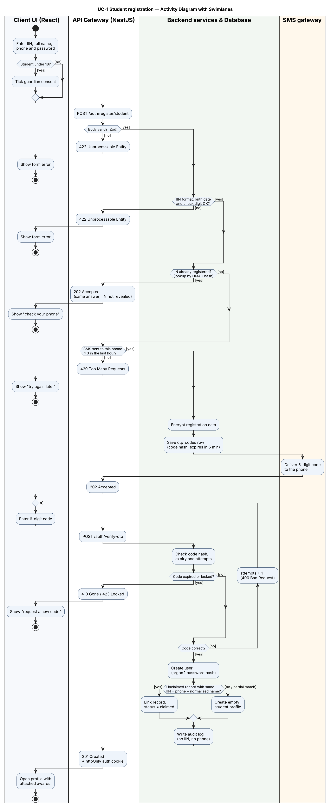
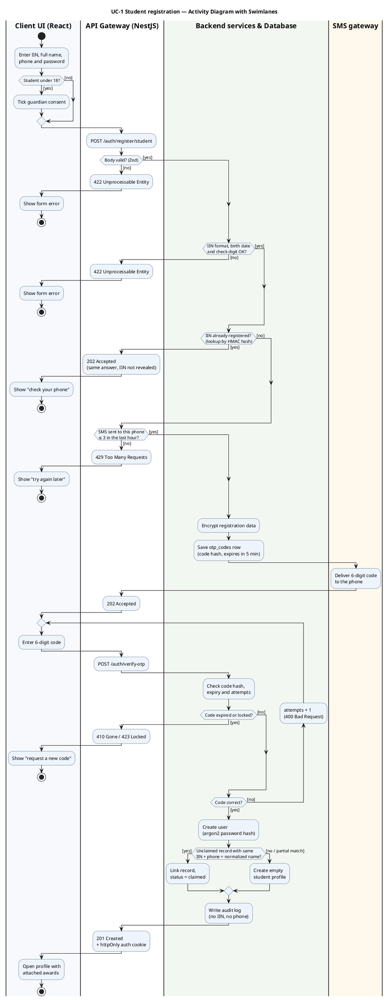

# Activity Diagram with Swimlanes — UC-1 Student registration

Part of [specifications.md](../../specifications.md), UC-1. Requirements: FR-7 – FR-11, NFR-5, NFR-7.

**How to read it.** Each vertical lane is one layer of the system and owns the actions inside it:

| Swimlane | Technology | Responsibility |
|---|---|---|
| **Client UI** | React 19 + Zustand | Collects input, shows errors, keeps the form state |
| **API Gateway** | NestJS controller + Zod | Receives HTTP requests, validates the body, applies rate limits, returns status codes |
| **Backend services & Database** | NestJS services, Prisma, PostgreSQL | Business rules, encryption, hashing, matching, writing rows |
| **SMS gateway** | External provider (mock in development) | Delivers the 6-digit code |

Drawn with PlantUML, which supports real UML swimlanes. Black dot = start, circled dot = end. Diamonds are decisions; the condition for each branch is written on the arrow in square brackets. The flow crosses a lane boundary every time one layer hands work to another.

PlantUML source (<code>activity-diagram.puml</code>)

## Notes for the defense

- **Why the IIN check sits in the backend lane and not only in the client:** the client can be bypassed, so the server always validates again (NFR-3).
- **Why "IIN already registered" returns the same 202 as success:** a different answer would let anyone test whether an IIN is in the registry (UC-1 A2).
- **Why the SMS lane is separate:** the SMS provider is outside our system boundary; in development a mock provider prints the code to the console.
- **Partial match never attaches awards:** if only the IIN matches but the name or phone differs, the student gets an empty profile (FR-10). This protects against someone registering with another person's IIN.
