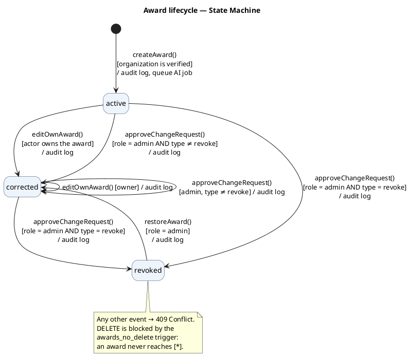
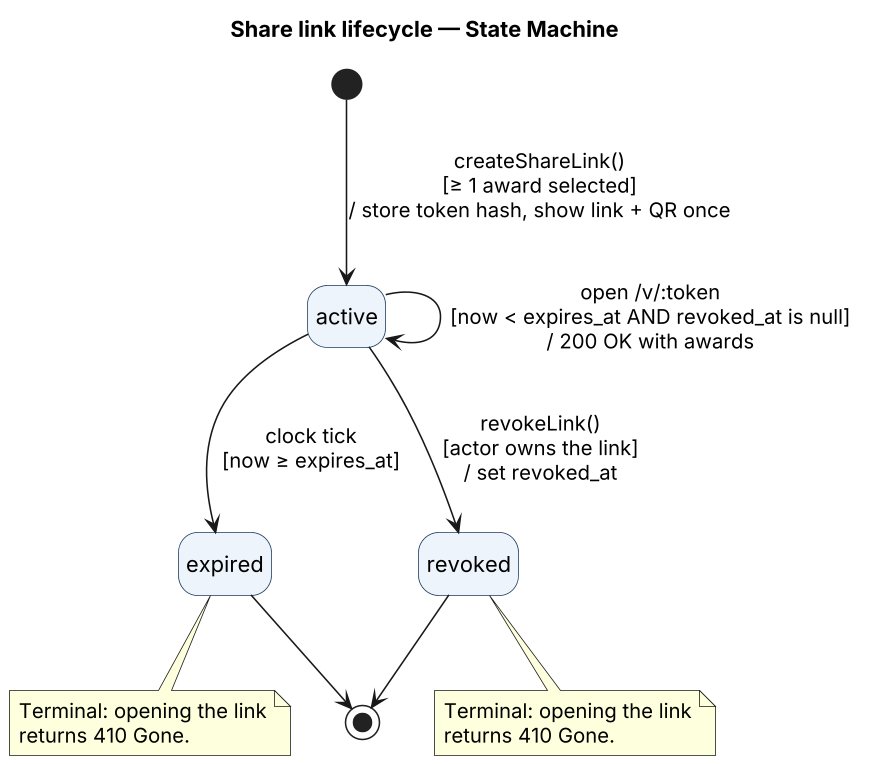
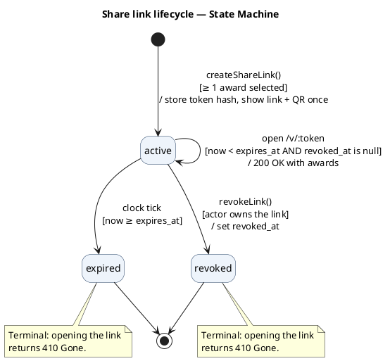
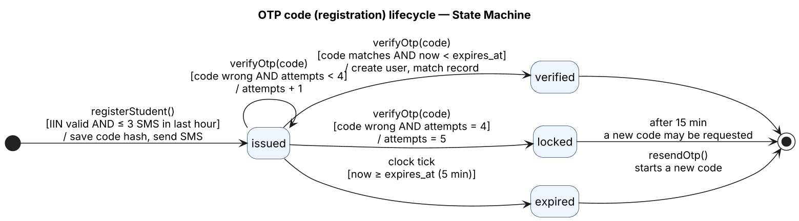
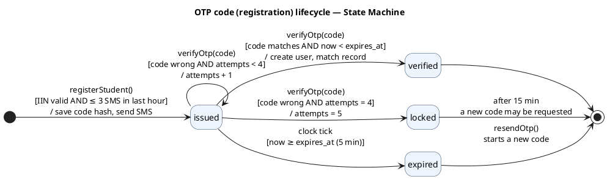

# State Machine Diagrams

Part of [specifications.md](../../specifications.md), section 9. Requirements: FR-5, FR-6, FR-8, FR-15, FR-19, NFR-7.

**How to read it.** Each label is `trigger [guard] / effect`:

- **trigger**: the event or call that starts the transition;
- **[guard]**: a condition that must be true, otherwise the transition is refused;
- **/ effect**: what the system does during the transition.

Drawn with PlantUML; the `.puml` sources are next to the images.

A transition that is not drawn is illegal and the API refuses it (409 Conflict). The database also blocks the most important illegal action, deleting an award, with a trigger.

## 1. Award lifecycle

An award is never deleted (FR-19). It only moves between three states.

PlantUML source (<code>state-machine-award.puml</code>)

## 2. Share link lifecycle

PlantUML source (<code>state-machine-share-link.puml</code>)

## 3. OTP code (registration session) lifecycle

PlantUML source (<code>state-machine-otp.puml</code>)

## Guard summary

| Entity | Transition | Guard | If the guard fails |
|---|---|---|---|
| Award | create | organization is `verified` | 403 |
| Award | edit | actor owns the award | 403 |
| Award | revoke / restore | role = admin | 403 |
| Award | anything from `revoked` except restore | — | 409 |
| Share link | open | `now < expires_at` and not revoked | 410 |
| OTP | verify | code matches, not expired, attempts < 5 | 400 / 410 / 423 |
| OTP | issue | ≤ 3 SMS per phone per hour | 429 |
