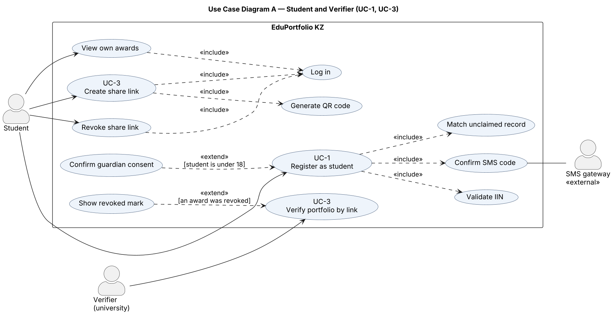
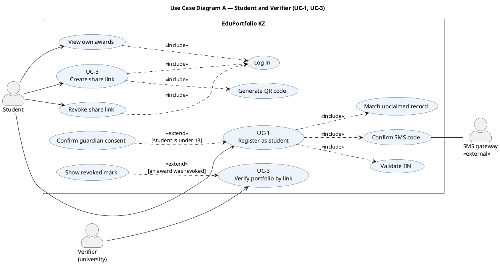
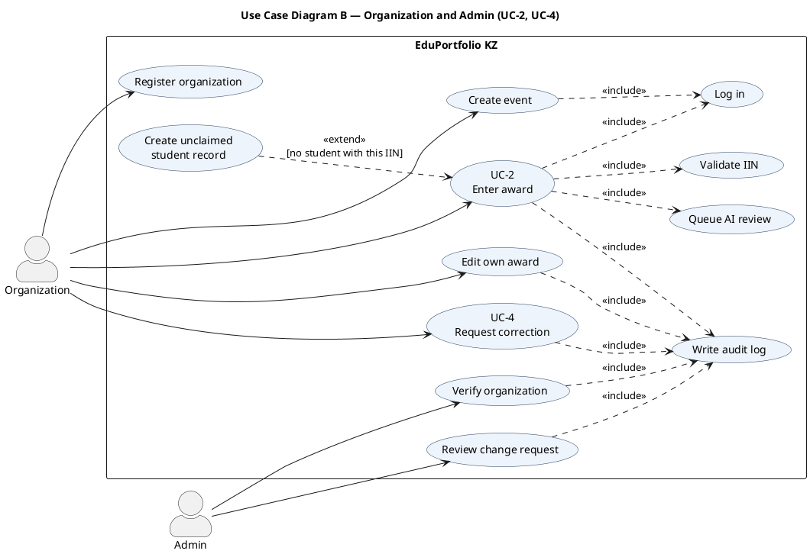
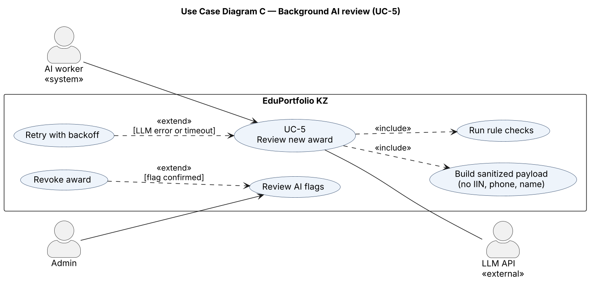
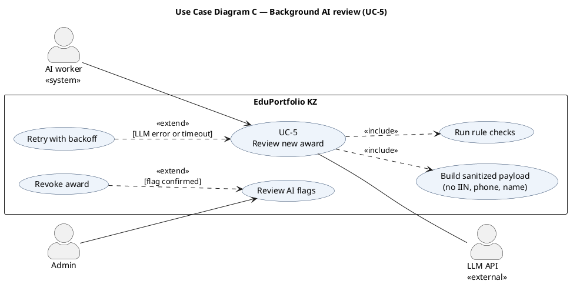

# Use Case Diagram

Part of [specifications.md](../../specifications.md), section 5. Requirements: FR-1 – FR-25.

Drawn with PlantUML (proper UML notation for actors and use cases); the `.puml` source files are next to the images.

**How to read it.** Actors stand outside the system boundary. Ovals inside the boundary are use cases. A solid line connects an actor to the use case it takes part in.

- `«include»`: a **mandatory** step that always runs as part of the base use case (the arrow points from the base use case to the included one).
- `«extend»`: an **optional** step that runs only under a condition, shown in square brackets (the arrow points from the extension to the base use case).

To keep the lines readable, the system is drawn as three diagrams that share one system boundary: A covers students and verifiers, B covers organizations and the admin, C covers the background AI review.

### A. Student and Verifier (UC-1, UC-3)

PlantUML source (<code>use-case-student.puml</code>)

### B. Organization and Admin (UC-2, UC-4)

PlantUML source (<code>use-case-organization.puml</code>)

### C. Background AI review (UC-5)

PlantUML source (<code>use-case-ai.puml</code>)

## Use case specifications

### UC-1: Register as student

| Field | Specification |
|---|---|
| **Use case ID** | UC-1 |
| **Primary actor** | Student |
| **Secondary actors** | SMS gateway (external) |
| **Pre-conditions** | The student has a 12-digit IIN and a phone that receives SMS; no account exists for this IIN. |
| **Post-conditions** | A user account exists; the student record is `claimed`; the OTP code is `verified`; the event is in the audit log. |
| **Main success scenario** | 1. Student enters IIN, full name, phone and password. 2. System validates the IIN format, birth date and check digit (`«include»` Validate IIN). 3. System sends a 6-digit code by SMS, valid for 5 min. 4. Student enters the code (`«include»` Confirm SMS code). 5. System creates the user and links the matching unclaimed record (`«include»` Match unclaimed record). 6. Student sees the profile with all attached awards. |
| **Extension** | 1a. IIN shows the student is under 18 → `«extend»` Confirm guardian consent; without consent registration is blocked. |
| **Exception flows** | 2a. Invalid IIN → 422, no SMS sent. 2b. IIN already registered → generic failure that does not reveal the IIN exists. 4a. Wrong code → attempts + 1; after 5 attempts → `locked` for 15 min (423). 4b. Code expired → 410; student requests a new code (max 3 per hour). 5a. No full match (IIN + name + phone) → empty profile; awards are never attached on a partial match. |
| **Requirements** | FR-7 – FR-11, NFR-5, NFR-7 |

### UC-2: Enter award

| Field | Specification |
|---|---|
| **Use case ID** | UC-2 |
| **Primary actor** | Organization (status `verified`) |
| **Secondary actors** | — |
| **Pre-conditions** | The organization is `verified`; the staff user is logged in; the event exists. |
| **Post-conditions** | The award exists with status `active`; an audit entry and an AI review job are created. |
| **Main success scenario** | 1. Organization opens its event and adds an award (`«include»` Log in). 2. System validates IIN and fields (`«include»` Validate IIN). 3. System finds the student by IIN hash or creates an `unclaimed` record. 4. System saves the award as `active` and writes the audit log (`«include»` Write audit log). 5. System queues an AI review job. |
| **Exception flows** | 1a. Organization not `verified` → 403. 2a. Invalid IIN or missing field → 422, nothing saved. 3a. A record with this IIN has a different name or phone → 409 "participant data does not match". 4a. Document number already used by this organization → 409. |
| **Requirements** | FR-2 – FR-4, FR-21, NFR-12 |

### UC-3: Create share link / Verify portfolio by link

| Field | Specification |
|---|---|
| **Use case ID** | UC-3 |
| **Primary actors** | Student (creates the link), Verifier (opens it) |
| **Secondary actors** | — |
| **Pre-conditions** | The student is logged in and has at least one award. |
| **Post-conditions** | A share link exists; only the token's hash is stored; revocation makes the link unusable immediately. |
| **Main success scenario** | 1. Student selects awards and a validity period (`«include»` Log in). 2. System creates a random token, stores its SHA-256 hash, shows the link once with a QR code (`«include»` Generate QR code). 3. Verifier opens the link. 4. System checks the token, expiry and revocation and shows name, awards, organization, date, document number and status. IIN and phone are never shown. |
| **Extension** | 4a. One of the awards was revoked after the link was created → `«extend»` Show revoked mark. |
| **Exception flows** | 4b. Unknown token → 404 with no hints. 4c. Link expired or revoked → 410. 4d. Too many requests from one IP → 429. |
| **Requirements** | FR-13 – FR-17, NFR-7 |

### UC-4: Request correction

| Field | Specification |
|---|---|
| **Use case ID** | UC-4 |
| **Primary actors** | Organization (requests), Admin (reviews change request) |
| **Pre-conditions** | The award belongs to the organization; the organization is `verified`. |
| **Post-conditions** | The award status reflects the decision; the audit log holds before and after values. |
| **Main success scenario** | 1. Organization requests a global change (change of IIN, revoke, merge) with a reason. 2. System creates a change request `pending` and writes the audit log (`«include»`). 3. Admin approves (`«include»` Write audit log). 4. System applies the change; the award becomes `corrected` or `revoked`. |
| **Exception flows** | 1a. Not the award's owner → 403. 1b. Award already `revoked` → 409 (only an Admin restore is allowed). 3a. Admin rejects → a comment is required; the award is unchanged. |
| **Requirements** | FR-5, FR-6, FR-18, FR-19 |

### UC-5: Review new award (AI)

| Field | Specification |
|---|---|
| **Use case ID** | UC-5 |
| **Primary actor** | AI worker (system actor) |
| **Secondary actors** | LLM API (external), Admin (reviews flags) |
| **Pre-conditions** | A review job is `queued` and its `run_after` time has passed. |
| **Post-conditions** | A flag exists for a suspicious award, or no flag if nothing was found. The award status is never changed by the worker. |
| **Main success scenario** | 1. Worker takes the job and builds a sanitized payload without IIN, phone or name. 2. Worker runs rule checks and asks the LLM about plausibility. 3. Worker saves an `ai_flag` with score and reasons. 4. Admin confirms or dismisses the flag (Review AI flags). |
| **Extension** | 2a. LLM error or timeout → `«extend»` Retry with backoff (up to 3 times); after that the job is `failed`. |
| **Exception flows** | 2b. Invalid model output → discarded; only rule-check results are saved. |
| **Requirements** | FR-21 – FR-24 |
