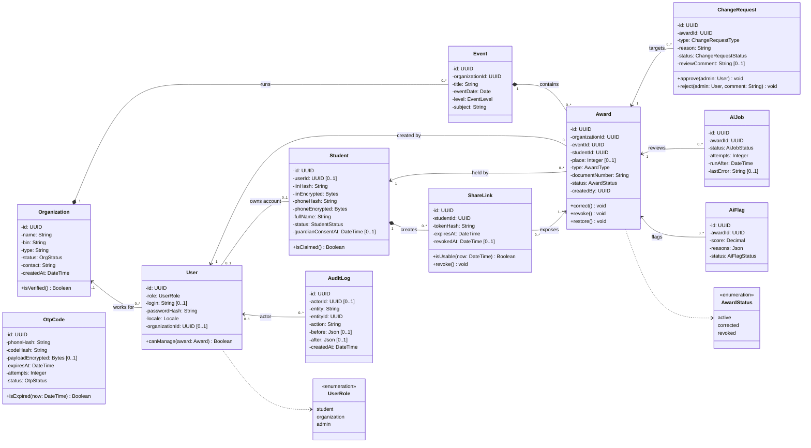
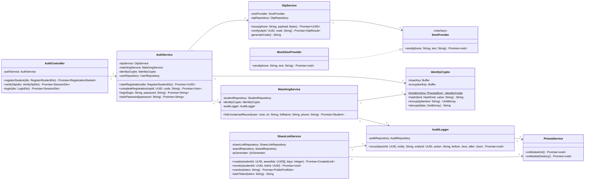
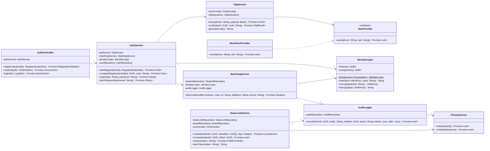

# UML Class Diagram

Part of [specifications.md](../../specifications.md), sections 8 and 10. The entities match [`backend/prisma/schema.prisma`](../../../backend/prisma/schema.prisma) and [database-schema.md](../../database-schema.md).

**How to read it.**
- `-` private, `+` public, `#` protected.
- `name: Type` is an attribute; `method(param: Type): ReturnType` is an operation.
- Numbers at the ends of a line are **cardinalities**: `1` exactly one, `0..1` optional, `0..*` any number, `1..*` at least one.
- Solid line with a diamond (`*--`) is composition: the part cannot exist without the whole. A plain line (`-->`) is an association. A dashed line with a hollow triangle (`..|>`) means "implements an interface".

## 1. Domain model (entities)

## 2. Service layer (registration and sharing)

Signatures of `IdentityCrypto` and the IIN functions are taken from the implemented code; the other services are designed and will be implemented in the next sprints.

