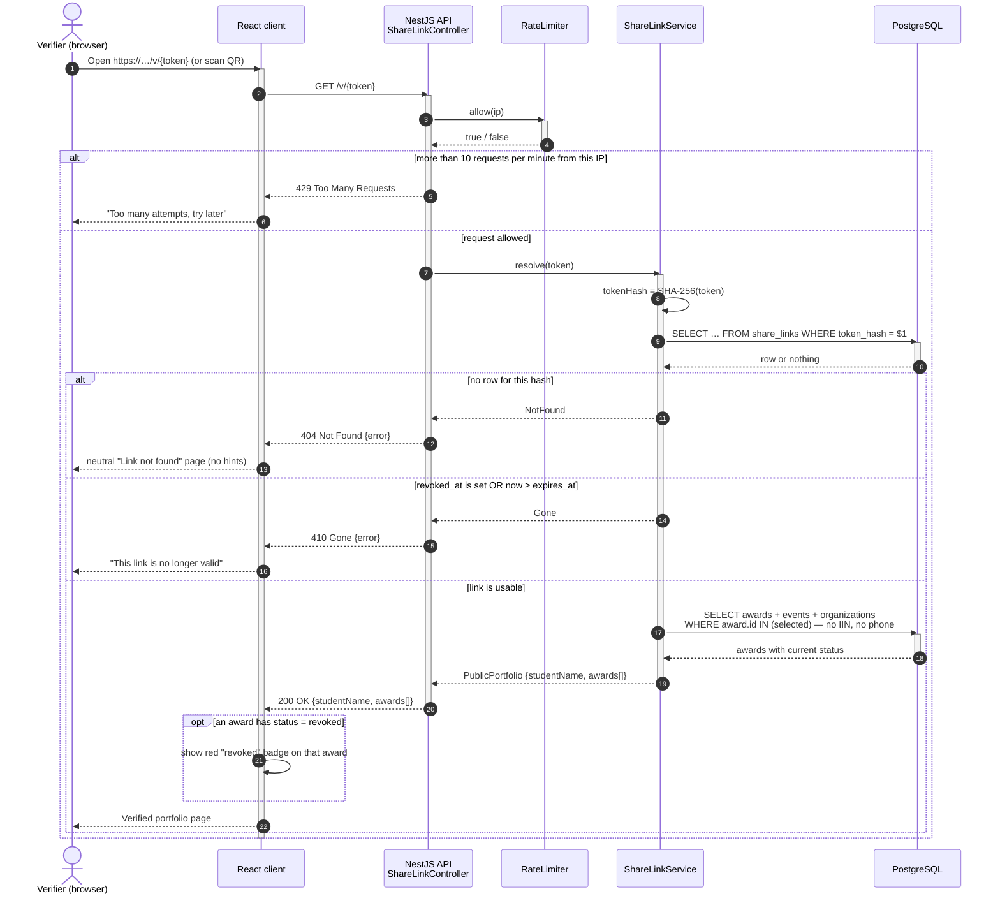
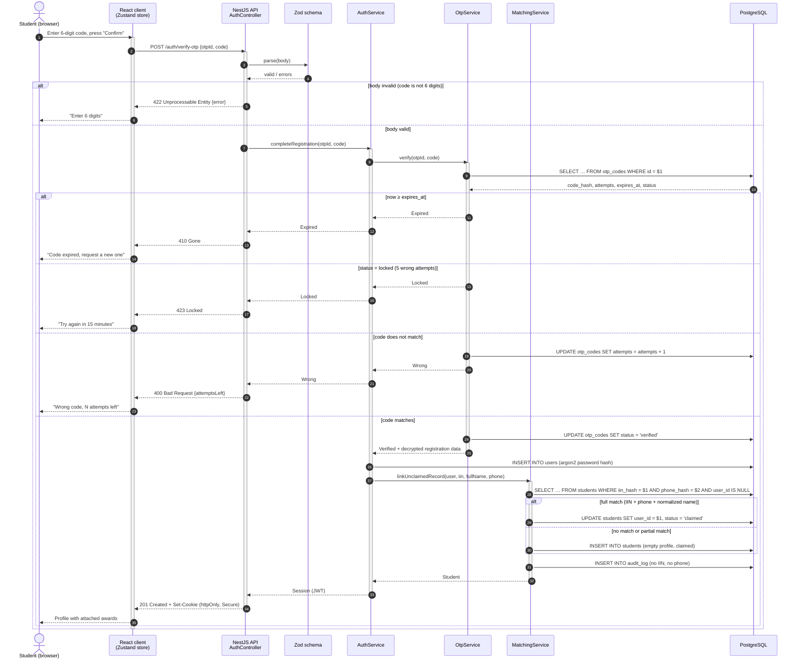

# UML Sequence Diagrams

Part of [specifications.md](../../specifications.md), section 11. Requirements: FR-7 – FR-17, NFR-5, NFR-7.

**How to read it.** Time runs from top to bottom. Each vertical line (lifeline) is one participant. A solid arrow `->>` is a request or call, a dashed arrow `-->>` is a response. A bar on a lifeline means the participant is busy handling the call (activation). An `alt` box contains alternative branches: only one runs, chosen by the condition in brackets. Every HTTP response shows its status code.

## 1. UC-3: University verifies a portfolio by link

## 2. UC-1: Student confirms the SMS code

